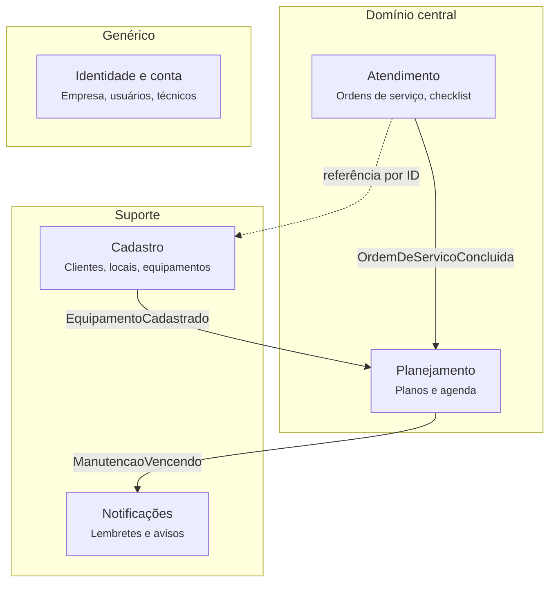
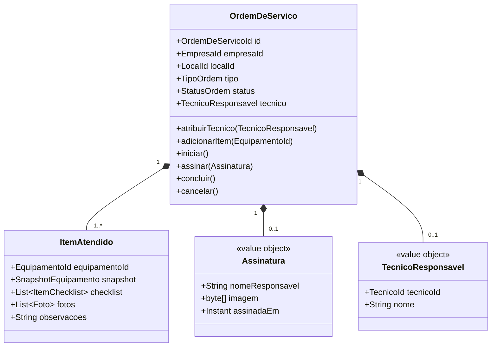
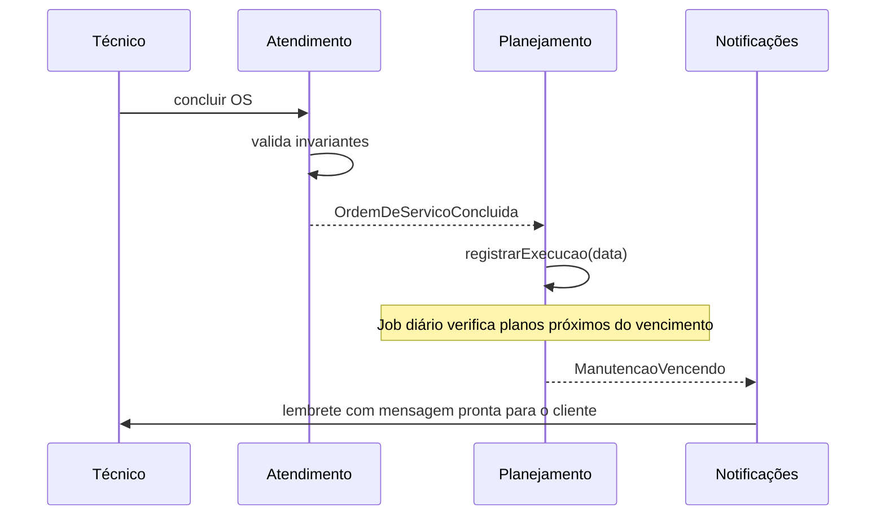

# Climora — Documento de Arquitetura

> Sistema de gestão de manutenção para técnicos e empresas de ar-condicionado, com foco em manutenção preventiva e conformidade com o PMOC.

**Status:** em design · **Stack prevista:** Java, Spring Boot, Spring Modulith, PostgreSQL

---

## Sumário

1. [Contexto e problema](#1-contexto-e-problema)
2. [Requisitos funcionais](#2-requisitos-funcionais)
3. [Modelagem do domínio](#3-modelagem-do-domínio)
4. [Contextos delimitados](#4-contextos-delimitados)
5. [Agregados](#5-agregados)
6. [Eventos de domínio](#6-eventos-de-domínio)
7. [Decisões de arquitetura](#7-decisões-de-arquitetura)
8. [Estrutura do projeto](#8-estrutura-do-projeto)
9. [Próximos passos](#9-próximos-passos)

---

## 1. Contexto e problema

No Brasil, a Lei 13.589/2018 obriga edifícios de uso público e coletivo climatizados (escritórios, clínicas, lojas, escolas) a manter um **PMOC — Plano de Manutenção, Operação e Controle**, com registro periódico das manutenções de cada equipamento.

Na prática, muitos técnicos autônomos e pequenas empresas de manutenção controlam clientes, aparelhos e preventivas de memória, em papel ou em planilhas. Isso gera três problemas:

- **Receita perdida:** preventivas esquecidas significam clientes que não voltam a chamar.
- **Falta de rastreabilidade:** não há histórico confiável por equipamento.
- **Dificuldade de conformidade:** montar o PMOC e os relatórios exigidos é trabalho manual e demorado.

O Climora resolve isso com um fluxo simples: cada aparelho recebe uma etiqueta com QR Code, o técnico registra o atendimento pelo celular, e o sistema mantém o histórico, agenda as próximas preventivas e lembra o técnico e o cliente.

---

## 2. Requisitos funcionais

### MVP

| Código | Módulo | Requisito |
|---|---|---|
| RF01 | Conta | O técnico deve poder criar conta e fazer login com e-mail e senha. |
| RF02 | Conta | O técnico deve poder cadastrar os dados da empresa (nome, CNPJ/CPF, telefone, logo), exibidos nos documentos gerados. |
| RF03 | Clientes | O técnico deve poder cadastrar, editar e inativar clientes, pessoa física ou jurídica. |
| RF04 | Clientes | Cada cliente deve poder ter um ou mais locais (unidades/filiais). |
| RF05 | Clientes | O técnico deve poder buscar clientes por nome, telefone ou documento. |
| RF06 | Equipamentos | O técnico deve poder cadastrar equipamentos vinculados a um local, com tipo, marca, modelo, capacidade (BTUs), número de série e ambiente. |
| RF07 | Equipamentos | O sistema deve gerar um QR Code único por equipamento, pronto para impressão como etiqueta. |
| RF08 | Equipamentos | Ao escanear o QR Code, o técnico autenticado deve ser levado à ficha do equipamento. |
| RF09 | Equipamentos | A ficha do equipamento deve exibir o histórico completo de manutenções, incluindo o técnico responsável por cada atendimento. |
| RF10 | Atendimento | O técnico deve poder abrir uma ordem de serviço (OS) para um ou mais equipamentos de um local, do tipo preventiva, corretiva ou instalação, com um técnico responsável pela execução. |
| RF11 | Atendimento | A OS preventiva deve apresentar um checklist padrão, com cada item marcado como feito, não aplicável ou com problema. |
| RF12 | Atendimento | O técnico deve poder anexar fotos de antes e depois e registrar observações por equipamento. |
| RF13 | Atendimento | O cliente deve poder assinar a OS na tela do celular ao final do serviço. |
| RF14 | Atendimento | O sistema deve gerar a OS finalizada em PDF e permitir compartilhá-la por WhatsApp ou e-mail. |
| RF15 | Planejamento | O técnico deve poder definir a periodicidade de manutenção de cada equipamento. |
| RF16 | Planejamento | O sistema deve calcular automaticamente a próxima manutenção a partir da última OS concluída. |
| RF17 | Planejamento | O técnico deve visualizar uma agenda com manutenções vencidas, da semana e do mês. |
| RF18 | Notificações | O sistema deve avisar o técnico sobre manutenções próximas do vencimento. |
| RF19 | Notificações | O sistema deve gerar uma mensagem pronta para o técnico enviar ao cliente pelo WhatsApp, lembrando da preventiva. |

### Roadmap

| Código | Módulo | Requisito |
|---|---|---|
| RF20 | PMOC | Gerar o documento do PMOC de um local a partir dos equipamentos e do histórico de OS. |
| RF21 | PMOC | Registrar o responsável técnico e os dados da ART exigidos pela norma. |
| RF22 | Portal do cliente | O cliente deve poder acessar equipamentos, histórico e relatórios dos seus locais. |
| RF23 | Financeiro | Criar orçamentos com serviços e peças e convertê-los em OS após aprovação. |
| RF24 | Financeiro | Cadastrar contratos de manutenção recorrentes com valor e periodicidade. |
| RF25 | Financeiro | Gerar cobranças via Pix para contratos e OS avulsas, com acompanhamento do status de pagamento. |
| RF26 | Equipe | Cadastrar técnicos com perfis de acesso diferentes (dono, técnico). |
| RF27 | Equipe | Atribuir OS e agendamentos a técnicos específicos. |
| RF28 | Offline | Preencher OS sem internet, com sincronização posterior. |
| RF29 | Indicadores | Exibir indicadores como OS por mês, preventivas em atraso e faturamento. |

> **Decisão de escopo:** o RF19 gera um link `wa.me` com a mensagem pronta em vez de integrar com a API oficial do WhatsApp Business. Isso elimina custo e burocracia no MVP sem perder o valor principal, que é o lembrete chegar ao cliente.

---

## 3. Modelagem do domínio

O ponto de partida foi um esboço com as entidades Empresa, Cliente, Endereço, Equipamento, QR Code, Ordem de Serviço, Agenda e Lembretes. Ao refinar o modelo com DDD, três ajustes conceituais foram feitos:

**QR Code não é entidade.** É apenas a representação visual da identidade pública do equipamento. Virou o value object `CodigoEtiqueta` dentro do agregado `Equipamento`.

**Agenda e Lembretes não são entidades, são capacidades.** O conceito real do domínio é o **plano de manutenção** de cada equipamento (periodicidade e próxima data prevista). A agenda é um modelo de leitura sobre esses planos; os lembretes são reações a eventos.

**Endereço passou a ser Local.** Um endereço é um value object. O conceito de negócio é a **unidade do cliente** (ex.: "Clínica X — Filial Centro"), que tem nome, endereço e equipamentos. O PMOC é emitido por local, então o conceito precisa ser explícito. A ordem de serviço passa a se relacionar com o local e os equipamentos atendidos, e não apenas com o cliente.

### Linguagem ubíqua

| Termo | Significado |
|---|---|
| Empresa | O técnico autônomo ou a empresa de manutenção que utiliza o Climora (tenant). |
| Técnico | Profissional da empresa que executa os atendimentos. Pode ou não ter acesso ao sistema. |
| Técnico responsável (OS) | O técnico que executou e responde por uma ordem de serviço. |
| Responsável técnico (PMOC) | Profissional habilitado que assina o PMOC de um local. Papel distinto do técnico que executa a OS. |
| Cliente | Pessoa física ou jurídica atendida pela empresa. |
| Local | Unidade física de um cliente onde ficam os equipamentos. |
| Equipamento | Aparelho de climatização instalado em um local. |
| Ordem de serviço (OS) | Registro de um atendimento realizado em um ou mais equipamentos de um local. |
| Plano de manutenção | Regra de recorrência da manutenção preventiva de um equipamento. |
| Preventiva | Manutenção periódica programada. |
| Corretiva | Manutenção para corrigir uma falha. |

---

## 4. Contextos delimitados



| Contexto | Tipo | Responsabilidade |
|---|---|---|
| **Atendimento** | Central | Registrar atendimentos e garantir as regras de uma ordem de serviço válida. |
| **Planejamento** | Central | Manter os planos de manutenção e calcular as próximas preventivas. |
| **Cadastro** | Suporte | Manter clientes, locais e equipamentos. |
| **Notificações** | Suporte | Gerar lembretes a partir de eventos de outros contextos. |
| **Identidade e conta** | Genérico | Autenticação, usuários, perfis, técnicos e dados da empresa (tenant). |

Atendimento e Planejamento concentram o diferencial do produto e recebem a modelagem mais rica. Os demais contextos são deliberadamente simples.

---

## 5. Agregados

Regra geral: **agregados se referenciam apenas por ID**, nunca por associação de objeto, e todo agregado carrega `empresaId` para isolamento entre tenants.

### Identidade e conta

- **`Empresa`** — tenant do sistema; dados exibidos nos documentos gerados.
- **`Usuario`** — credenciais e perfil de acesso, vinculado a uma empresa.
- **`Tecnico`** (raiz) — profissional que executa atendimentos: nome, telefone, situação (ativo/inativo) e `usuarioId` opcional.

> `Tecnico` e `Usuario` são conceitos separados de propósito. `Usuario` responde a "quem pode acessar o sistema"; `Tecnico` responde a "quem executa o serviço". Um dono de empresa pode ser usuário sem atender em campo, e um ajudante pode ser técnico sem ter login. No caso do técnico autônomo, o cadastro da empresa cria automaticamente um `Tecnico` vinculado ao seu `Usuario`, então os dois papéis coincidem sem esforço extra.

### Cadastro

- **`Cliente`** (raiz)
  - `Documento` (VO) — valida CPF ou CNPJ e define o tipo de pessoa.
  - `Contato` (VO) — telefone e e-mail.
  - `Local` (entidade interna) — nome e `Endereco` (VO).
- **`Equipamento`** (raiz, agregado separado, referencia `localId`)
  - `Especificacao` (VO) — tipo, marca, modelo, capacidade em BTUs, número de série.
  - `Ambiente` (VO) — onde o aparelho está instalado no local.
  - `CodigoEtiqueta` (VO) — código público codificado no QR Code.

> `Equipamento` é um agregado próprio porque um cliente pode ter centenas de aparelhos. Mantê-los dentro de `Cliente` obrigaria a carregar todos eles para qualquer alteração cadastral e criaria contenção desnecessária de concorrência.

### Atendimento

- **`OrdemDeServico`** (raiz)
  - `TipoOrdem` — preventiva, corretiva, instalação.
  - `StatusOrdem` — aberta, em execução, concluída, cancelada.
  - `TecnicoResponsavel` (VO) — `tecnicoId` e um snapshot do nome do técnico no momento da execução.
  - `ItemAtendido` (entidade interna) — um por equipamento: checklist, fotos, observações e um snapshot dos dados do equipamento no momento do atendimento.
  - `Assinatura` (VO) — assinatura do cliente e data/hora.

**Invariantes:**

1. Uma OS não pode ser concluída sem pelo menos um equipamento atendido.
2. Uma OS preventiva só pode ser concluída com o checklist completamente preenchido.
3. A conclusão exige a assinatura do cliente.
4. Uma OS concluída é imutável.
5. Uma OS só pode ser iniciada com um técnico responsável definido.
6. O técnico responsável só pode ser trocado enquanto a OS não estiver concluída, e apenas para um técnico ativo da mesma empresa.

> Os snapshots em `ItemAtendido` e `TecnicoResponsavel` são intencionais: o histórico deve refletir o equipamento e o técnico como estavam no dia do atendimento, mesmo que os cadastros sejam alterados ou o técnico deixe a empresa.



### Planejamento

- **`PlanoDeManutencao`** (raiz, um por equipamento)
  - `Periodicidade` (VO) — mensal, trimestral, semestral etc.
  - `ultimaExecucao` e `proximaPrevista`.
  - Comportamento central: `registrarExecucao(data)`, que recalcula a próxima data prevista.

A **agenda** não é um agregado: é um modelo de leitura que consulta os planos por intervalo de datas.

### Notificações

Sem modelo de domínio rico. O contexto consome eventos e produz lembretes (no MVP, mensagens prontas para envio via WhatsApp).

---

## 6. Eventos de domínio

Os contextos não alteram o estado uns dos outros por chamadas diretas; a integração acontece por eventos. Esses eventos são também as **fronteiras naturais** para uma futura extração em microsserviços.

| Evento | Publicado por | Consumido por | Efeito |
|---|---|---|---|
| `EquipamentoCadastrado` | Cadastro | Planejamento | Cria um plano de manutenção para o equipamento. |
| `OrdemDeServicoConcluida` | Atendimento | Planejamento | Registra a execução e recalcula a próxima preventiva. |
| `ManutencaoVencendo` | Planejamento (job diário) | Notificações | Gera o lembrete para o técnico e o cliente. |



---

## 7. Decisões de arquitetura

### ADR-001 — Monólito modular em vez de microsserviços

**Contexto:** o produto está em fase de validação, com equipe de uma pessoa e volume baixo.

**Decisão:** construir um **monólito modular** com Spring Boot, com um módulo por contexto delimitado, usando **Spring Modulith** para verificar as fronteiras entre módulos em teste.

**Consequências:** um único deploy e baixo custo operacional agora, preservando a possibilidade de extrair contextos para serviços independentes quando houver motivo real (escala, ciclo de deploy ou equipe).

### ADR-002 — Regras de fronteira entre módulos

1. Nenhum relacionamento JPA atravessa contextos; entre contextos, apenas IDs.
2. A comunicação entre contextos acontece por eventos de domínio ou por uma interface pública mínima de cada módulo. Nenhum módulo acessa repositórios ou tabelas de outro.
3. Cada contexto possui suas próprias tabelas, separadas por schema no mesmo banco.

### ADR-003 — Eventos de domínio como mecanismo de integração

**Decisão:** no monólito, os eventos são publicados com o `ApplicationEventPublisher` do Spring, com publicação persistente via Spring Modulith para não perder eventos em caso de falha.

**Evolução:** ao extrair um contexto, os eventos passam a trafegar por um broker de mensagens, com o padrão **transactional outbox** garantindo consistência entre a gravação do agregado e a publicação do evento. O contexto de Planejamento é o candidato natural para a primeira extração.

### ADR-004 — Multi-tenancy por coluna

**Decisão:** isolamento entre empresas por `empresaId` em todos os agregados, aplicado de forma centralizada na camada de persistência.

**Motivo:** é o modelo mais simples de operar no início e atende bem ao volume esperado de pequenos clientes.

---

## 8. Estrutura do projeto

```
src/main/java/br/com/climora/
├── identidade/
│   ├── domain/
│   ├── application/
│   └── infrastructure/
├── cadastro/
│   ├── domain/          # Cliente, Local, Equipamento, VOs
│   ├── application/     # casos de uso
│   └── infrastructure/  # JPA, controllers
├── atendimento/
│   ├── domain/          # OrdemDeServico, ItemAtendido, Assinatura
│   ├── application/
│   └── infrastructure/
├── planejamento/
│   ├── domain/          # PlanoDeManutencao, Periodicidade
│   ├── application/     # inclui o modelo de leitura da agenda
│   └── infrastructure/
└── notificacoes/
    ├── application/
    └── infrastructure/
```

Cada módulo expõe apenas o que está no seu pacote raiz; os subpacotes são internos e protegidos pelas verificações do Spring Modulith.

---

## 9. Próximos passos

- [ ] Validar a linguagem ubíqua e o checklist da preventiva com técnicos da área.
- [ ] Implementar o agregado `OrdemDeServico` com as invariantes e testes de unidade.
- [ ] Implementar `PlanoDeManutencao` e o consumo de `OrdemDeServicoConcluida`.
- [ ] Configurar testes de arquitetura do Spring Modulith.
- [ ] Definir a estratégia de upload e armazenamento de fotos.
- [ ] Avaliar se o modo offline (RF28) precisa entrar no MVP.
